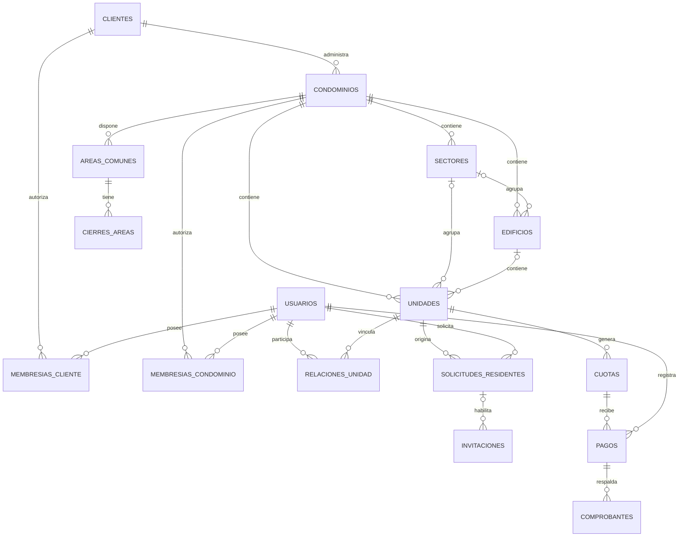

# AdminCond — Modelo de datos y diccionario V1

**Día de trabajo:** Día 3 — Diseño PostgreSQL  
**Estado:** Propuesta técnica v0.1, pendiente de revisión antes de implementar  
**Stack:** React + Node.js/Express + PostgreSQL

## 1. Alcance y principios

AdminCond es una plataforma SaaS multi-cliente. Un cliente (empresa o particular) puede administrar varios condominios; cada condominio conserva su independencia operativa y financiera. Los usuarios tienen identidades independientes de sus permisos y de sus relaciones con las unidades. **No se han creado tablas ni ejecutado pruebas**; este documento es diseño.

Principios: UUID como identificador; timestamps con zona horaria; claves foráneas y restricciones; autorización en backend por cliente, condominio, operación y recurso; auditoría; no guardar secretos ni contraseñas en texto plano. Para fechas civiles de ocupación se usa `DATE`. El diseño define ámbitos de acceso, no los concede automáticamente.

## 2. Diagrama entidad-relación — núcleo

**Nota:** las relaciones opcionales a `SECTORES` y `EDIFICIOS` no obligan a que existan. Una unidad puede depender directamente del condominio. Los permisos financieros y auditoría se detallan aparte para que el diagrama sea legible.

## 3. Diccionario de datos — entidades esenciales

Convenciones: `PK` clave primaria; `FK` clave foránea; `NN` obligatorio; `UQ` único; `NULL` opcional. Todas las tablas de negocio incluyen `created_at TIMESTAMPTZ NN` y, donde corresponda, `updated_at TIMESTAMPTZ NN`, aunque se omitan abajo para brevedad.

| Tabla | Campos clave propuestos | Finalidad |
|---|---|---|
| `clientes` | `id UUID PK`, `tipo VARCHAR(20) NN`, `nombre VARCHAR(150) NN`, `email_contacto VARCHAR(255)`, `estado VARCHAR(20) NN` | Empresa o particular que contrata el servicio. |
| `solicitudes_afiliacion` | `id UUID PK`, `solicitante_email VARCHAR(255) NN`, `cliente_id UUID NULL FK`, `datos_solicitud JSONB NN`, `estado VARCHAR(20) NN`, `revisado_por UUID NULL FK` | Revisión por Super Admin antes de habilitar el condominio. |
| `condominios` | `id UUID PK`, `cliente_id UUID NN FK`, `nombre VARCHAR(150) NN`, `direccion TEXT`, `pais_codigo CHAR(2) NN`, `estado VARCHAR(20) NN` | Independencia por condominio. |
| `sectores` | `id UUID PK`, `condominio_id UUID NN FK`, `nombre VARCHAR(100) NN` | Etapa/sector opcional. |
| `edificios` | `id UUID PK`, `condominio_id UUID NN FK`, `sector_id UUID NULL`, `nombre VARCHAR(100) NN` | Torre/bloque opcional. |
| `unidades` | `id UUID PK`, `condominio_id UUID NN FK`, `sector_id UUID NULL`, `edificio_id UUID NULL`, `codigo VARCHAR(30) NN`, `tipo VARCHAR(30) NN`, `piso INTEGER NULL`, `estado VARCHAR(20) NN` | Departamento, casa u otro tipo de unidad. |
| `usuarios` | `id UUID PK`, `nombre VARCHAR(100) NN`, `apellido VARCHAR(100)`, `email VARCHAR(255) NN`, `password_hash TEXT NULL`, `estado VARCHAR(20) NN` | Identidad y autenticación individual. Email único sin distinguir mayúsculas: definir `citext` o índice sobre `lower(email)`. |
| `membresias_cliente` | `id UUID PK`, `usuario_id UUID NN FK`, `cliente_id UUID NN FK`, `rol VARCHAR(30) NN`, `estado VARCHAR(20) NN`, `inicio TIMESTAMPTZ NN`, `fin TIMESTAMPTZ NULL` | Supervisión limitada al cliente. |
| `membresias_condominio` | `id UUID PK`, `usuario_id UUID NN FK`, `condominio_id UUID NN FK`, `rol VARCHAR(30) NN`, `estado VARCHAR(20) NN`, `inicio TIMESTAMPTZ NN`, `fin TIMESTAMPTZ NULL` | Acceso operacional solo al condominio asignado. |
| `relaciones_unidad` | `id UUID PK`, `usuario_id UUID NN FK`, `unidad_id UUID NN FK`, `tipo_relacion VARCHAR(30) NN`, `fecha_inicio DATE NN`, `fecha_fin DATE NULL` | Relaciones independientes: propietario, ocupante, responsable principal y responsable de pago. |
| `solicitudes_residentes` | `id UUID PK`, `unidad_id UUID NN FK`, `solicitado_por UUID NN FK`, `email_invitado VARCHAR(255) NN`, `estado VARCHAR(20) NN`, `revisado_por UUID NULL FK`, `revisado_at TIMESTAMPTZ NULL` | Responsable solicita alta; administrador revisa. |
| `invitaciones` | `id UUID PK`, `solicitud_id UUID NULL FK`, `condominio_id UUID NN FK`, `unidad_id UUID NULL FK`, `email_destino VARCHAR(255) NN`, `token_hash TEXT NN`, `expira_at TIMESTAMPTZ NN`, `usada_at TIMESTAMPTZ NULL`, `estado VARCHAR(20) NN` | Invitación de un solo uso tras autorización, sin guardar el token original. |
| `permisos` | `id UUID PK`, `codigo VARCHAR(100) NN UQ`, `descripcion TEXT` | Catálogo de capacidades específicas. |
| `asignaciones_permisos` | `id UUID PK`, `membresia_condominio_id UUID NN FK`, `permiso_id UUID NN FK`, `otorgado_por UUID NN FK`, `inicio TIMESTAMPTZ NN`, `revocado_at TIMESTAMPTZ NULL` | Permisos operativos explícitos para cada ámbito. |
| `cuotas` | `id UUID PK`, `condominio_id UUID NN`, `unidad_id UUID NN`, `periodo DATE NN`, `importe NUMERIC(12,2) NN`, `moneda CHAR(3) NN`, `vence_at DATE NN`, `estado VARCHAR(20) NN` | Obligaciones por unidad y periodo. |
| `pagos` | `id UUID PK`, `condominio_id UUID NN`, `cuota_id UUID NN`, `registrado_por UUID NN FK`, `validado_por UUID NULL FK`, `importe NUMERIC(12,2) NN`, `metodo VARCHAR(30) NN`, `estado VARCHAR(20) NN`, `validado_at TIMESTAMPTZ NULL` | Pago manual y validación separada; preparado para métodos futuros. |
| `comprobantes` | `id UUID PK`, `pago_id UUID NN FK`, `storage_key TEXT NN`, `nombre_original VARCHAR(255)`, `mime_type VARCHAR(100)`, `subido_por UUID NN FK` | Referencias a ficheros privados; nunca tarjeta ni contenido financiero sensible en rutas públicas. |
| `areas_comunes` | `id UUID PK`, `condominio_id UUID NN FK`, `nombre VARCHAR(100) NN`, `requiere_reserva BOOLEAN NN`, `estado VARCHAR(20) NN`, `reglas TEXT` | Servicios opcionales (piscina, billar, etc.). Reservas completas fuera de V1. |
| `cierres_areas` | `id UUID PK`, `area_id UUID NN FK`, `desde TIMESTAMPTZ NN`, `hasta TIMESTAMPTZ NULL`, `motivo TEXT NN` | Cierres temporales y mantenimiento. |
| `auditoria` | `id UUID PK`, `actor_id UUID NULL FK`, `cliente_id UUID NULL FK`, `condominio_id UUID NULL FK`, `accion VARCHAR(100) NN`, `recurso_tipo VARCHAR(80)`, `recurso_id UUID NULL`, `resultado VARCHAR(20) NN`, `fecha TIMESTAMPTZ NN` | Eventos relevantes, sin contraseñas/tokens. |

**Otras entidades V1 por detallar:** `comunicados`, `juntas`, `documentos`, `publicaciones_publicas` y sus reglas de visibilidad. No deben quedar olvidadas antes de congelar el esquema de implementación.

## 4. Integridad y restricciones críticas

1. **Consistencia de ámbito:** una unidad, su edificio/sector y cualquier cuota/pago deben pertenecer al mismo condominio. Usar claves candidatas `(id, condominio_id)` y FKs compuestas cuando una tabla referencie simultáneamente ambos campos; por ejemplo `(edificio_id, condominio_id) → edificios(id, condominio_id)`. El mismo patrón se aplica a `sectores`, `unidades` y `cuotas`/`pagos`.
2. **Un responsable principal activo por unidad:** índice único parcial sobre `(unidad_id)` para `tipo_relacion = 'RESPONSABLE_PRINCIPAL' AND fecha_fin IS NULL`. La regla de vigencia necesita política adicional de fechas y prevención de periodos solapados.
3. **Unicidad de unidades:** `codigo` único dentro del condominio **solo si es un identificador completo**, por ejemplo `TORRE-A-302`; de lo contrario la unicidad deberá considerar edificio/sector y tratar correctamente los `NULL`.
4. **Finanzas:** `importe > 0`, moneda ISO 4217, estados validados; una cuota puede recibir varios pagos. El saldo confirmado solo considera pagos aprobados. Diseñar operaciones en transacciones para evitar duplicados o doble validación.
5. **Separación de funciones:** `registrado_por <> validado_por` si este último existe; comprobación de permisos vigente en backend y registro de auditoría.
6. **Invitaciones:** no activar acceso sin aprobación; `token_hash` único, expiración y consumo atómico de un solo uso. Verificar el email y el destino de la invitación.
7. **Permisos sensibles RN-18:** el Supercliente autorizado concede/revoca, con autenticación reforzada y auditoría. El backend consulta permisos vigentes, no se basa solo en claims obsoletos de JWT.
8. **No filtración entre clientes:** todas las consultas privadas limitan por membresía/relación vigente y ámbito comprobado por servidor. Nunca aceptar `cliente_id` del frontend como prueba de autorización.
9. **Historial:** no borrar físicamente pagos aprobados ni vínculos pasados; conservar trazabilidad y definir anulaciones controladas.
10. **Cierres:** `hasta > desde` cuando exista, y solo áreas del condominio autorizado.

## 5. Escenarios de revisión del DER

| Escenario | Comprobación esperada |
|---|---|
| Empresa con tres condominios | Una fila en `clientes`, tres en `condominios`; sus registros financieros separados. |
| Casa sin torre | `unidades.condominio_id` obligatorio; `sector_id` y `edificio_id` nulos. |
| Propietaria distinta de inquilino | Dos usuarios relacionados con la misma unidad mediante tipos distintos. |
| Responsable que se muda | Finaliza relación sin borrar historial; nuevo responsable activo permitido. |
| Invitación a conviviente | Solicitud pendiente → aprobación del administrador → token de un solo uso. |
| Pago registrado por residente | No cuenta como confirmado hasta validación autorizada independiente. |
| Edificio de otro condominio | FK compuesta o restricción equivalente impide vínculo incorrecto. |
| Admin intenta validar pago sin permiso | Denegación en backend y evento de auditoría. |

## 6. Pendientes de diseño, sin bloquear el núcleo

- Forma exacta de implementar `roles` y permisos compuestos evitando concesiones contradictorias.
- Si propietarios no residentes tendrán acceso opcional y su autorización específica.
- Políticas para delegación financiera, pagos parciales, conciliación y titular de cuenta receptora (especialmente V2 con pasarela).
- Flujo de soporte excepcional del Super Admin y retención de auditoría.
- Normalización de datos personales, políticas de borrado y cumplimiento según país.
- Detalle de `comunicados`, `juntas`, `documentos` y `publicaciones_publicas`.
- Modelo futuro de reservas de áreas comunes y restricciones de solapamiento.
